# Manual de usuario de DePaso

*Ahorrá en el camino.* DePaso te ayuda a decidir **dónde conviene comprar** según el recorrido
que ya vas a hacer ese día, no solo según el precio más bajo.

Este manual también está en PDF con las pantallas: [manual/DePaso-Manual-de-usuario.pdf](manual/DePaso-Manual-de-usuario.pdf).
Si sos quien instala o desarrolla la app, mirá la [Guía de instalación](GUIA-DE-INSTALACION.md).

> Los precios y nombres que ves en las capturas son **ejemplos ficticios**.

---

## 1. Primeros pasos

### Abrir la app
Instalá el APK de DePaso en tu Android (o abrila con Expo Go si es una prueba). También podés
usarla desde el navegador de tu compu o celular: se ve igual que en el teléfono, en una columna
centrada. Al entrar por primera vez vas a ver la bienvenida con dos opciones: **crear cuenta** o
**iniciar sesión**.

### Crear una cuenta
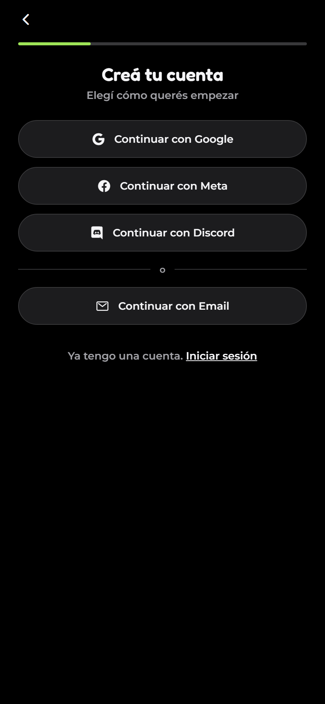

1. Tocá **Crear cuenta**.
2. Marcá las tres casillas obligatorias: que sos **mayor de 18 años**, que aceptás los
   **Términos y Condiciones** y que leíste la **Política de Privacidad**. La cuarta (novedades y
   promociones) es opcional.
3. Elegí cómo registrarte:
   - **Continuar con Google, Meta o Discord**: se abre la pantalla de esa red para autorizar.
   - **Continuar con Email**: completás nombre, email y una contraseña de al menos 8 caracteres.
4. Después de crear la cuenta, la app te pide permiso de **ubicación** (para calcular rutas) y
   te deja guardar tus **lugares** habituales (casa, trabajo…). Podés saltearlo y hacerlo más tarde.

### Iniciar sesión
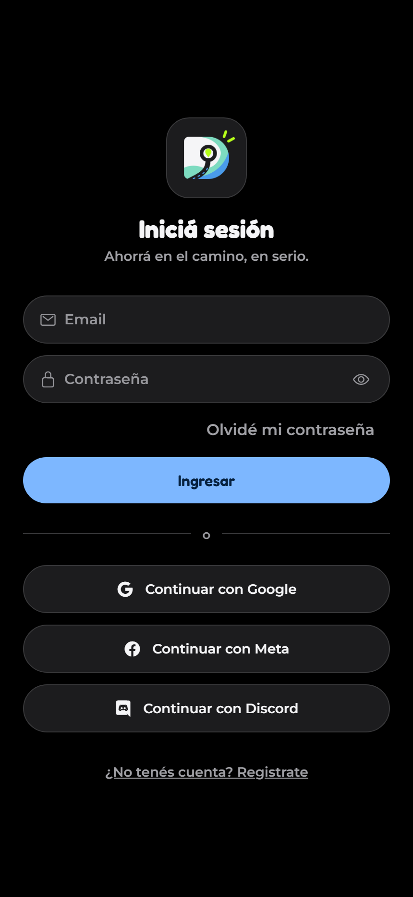

Con tu email y contraseña, o con el botón de Google, Meta o Discord. La app **recuerda tu cuenta**:
no tenés que volver a entrar cada vez que la abrís. Por seguridad, la sesión se renueva sola cada
15 minutos y dura hasta 30 días sin usar la app.

> Si usás una red social y todavía no tenés cuenta, la app te lleva a crearla primero.

### Olvidé mi contraseña
Son tres pantallas, sin salir de la app:

1. **Email.** Poné el email de tu cuenta y tocá **Mandame el código**.
2. **Código.** Te llega un mail con un código de **8 dígitos**. Escribilo o pegalo: se verifica
   solo. Si no te llegó, mirá en spam o tocá **Reenviar código** (habilita a los 30 segundos).
3. **Contraseña nueva.** Escribila **dos veces**. Tocá **Guardar contraseña** y entrá con la nueva.

El código vale unos 20 a 30 minutos y se puede usar una sola vez.

---

## 2. Pantalla principal

Abajo tenés la barra con cinco pestañas:

| Pestaña | Para qué sirve |
|---|---|
| **Inicio** | Armar tu recorrido de hoy y encontrar la mejor compra |
| **Listas** | Tus listas de compras |
| **Mapa** | El recorrido activo con los comercios |
| **Actividad** | Novedades de DePaso y avisos pensados para vos |
| **Perfil** | Tu cuenta, preferencias y configuración |

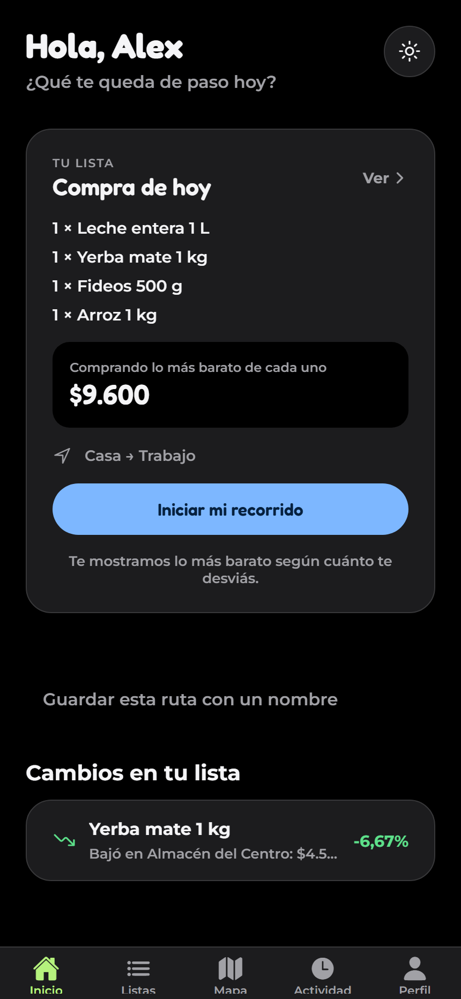

### Inicio
- Arriba hay **una sola tarjeta, "Iniciar mi recorrido"**. Te muestra tu lista y tu recorrido, y el
  botón cambia según lo que te falte: **Armar mi lista**, **Elegir mi recorrido**, **Iniciar mi
  recorrido** o **Ver mi compra de paso**.
- Con la lista y el recorrido listos, el botón compara los precios de los comercios cercanos a tu
  camino y te muestra hasta **3 opciones**.
- Más abajo, **Cambios en tu lista**: productos que **subieron o bajaron** de precio hace poco y
  las **ofertas de hoy** (tus medios de pago aparecen primero, con la etiqueta "Tuya").

### El recorrido de hoy
Lo que armás en **Inicio** (tu lista y por dónde andás) queda **guardado todo el día** y se
reinicia solo a las **00:00**. Si querés repetir un recorrido otro día, tocá **Guardar esta ruta
con un nombre** y después elegila desde tus rutas guardadas.

---

## 3. Listas de compras

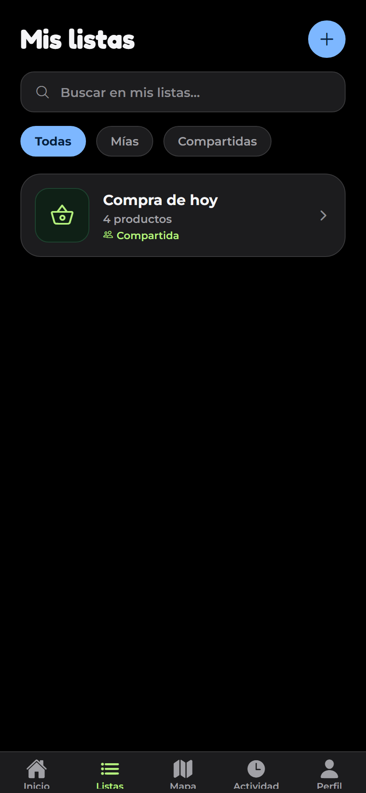

### Crear y abrir una lista
En **Listas**, tocá el botón **+** y poné un nombre ("Compra semanal"). Tocá una lista para abrirla.
Podés buscar y filtrar entre **Todas**, **Mías** y **Compartidas**.

### Agregar productos
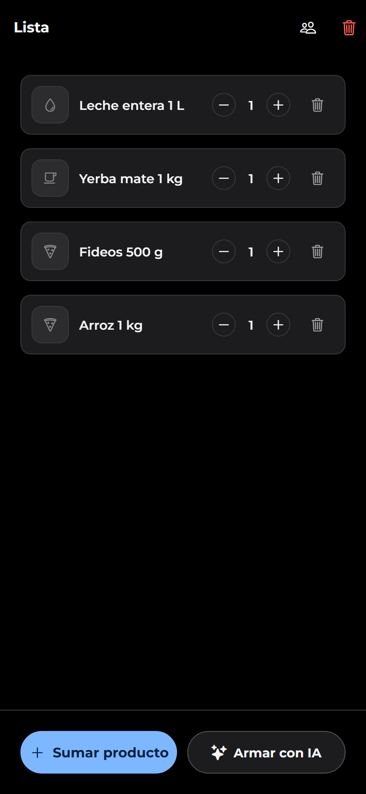

Tenés tres formas:

**a) Buscando.** Tocá **+ Sumar un producto** y escribí lo que necesitás ("arroz"). Los productos
más comunes aparecen primero (el arroz antes que una galletita de arroz) y cada resultado muestra
su **foto** (cuando existe), marca y tamaño. Tocá **Sumar** para agregarlo.

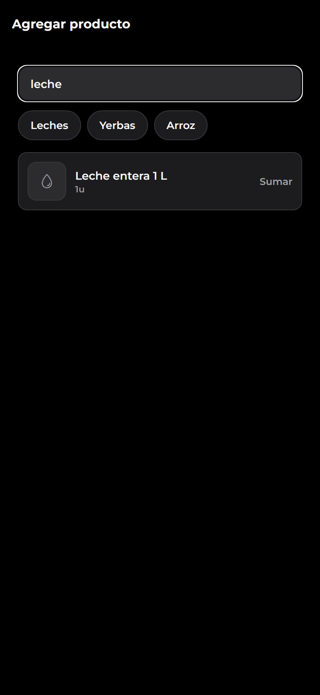

**b) Filtrando.** Debajo del buscador hay botones para afinar:
- **Tipo** (Gaseosas, Vinos, Shampoo, Yerba…): tocá uno para ver solo ese tipo. Podés usarlo
  **sin escribir nada** para explorar.
- **Marca**: abre una lista con las marcas y cuántos productos tiene cada una.
- **Limpiar filtros** los saca todos.

**c) Con inteligencia artificial.** Es la más rápida (ver la siguiente sección).

### Cambiar cantidades y quitar productos
Dentro de la lista usá **−** y **+** para la cantidad y la **✕** para quitar un producto.

### Compartir una lista
Dentro de la lista tocá la fila **Compartir lista**, escribí el email de alguien que **ya use
DePaso** y tocá **Compartir**. Esa persona la ve en sus listas y puede agregar o quitar
productos, y le llega un aviso en **Actividad**. Para dejar de compartir, tocá **Quitar** junto a
su nombre; quien recibió la lista puede tocar **Salir**.

---

## 4. Armar la lista con IA (hablando)

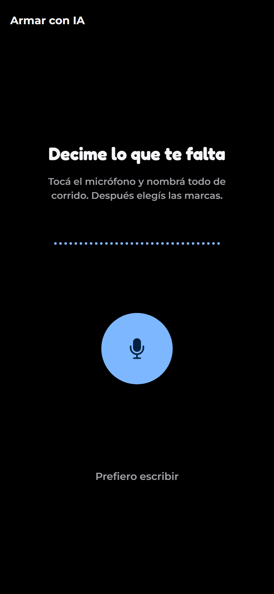

1. Abrí una lista y tocá el botón **✨ IA** (arriba a la derecha, o abajo junto a *Sumar un
   producto*). En una lista vacía también hay un botón **Armar con IA**.
2. La primera vez te pide permiso para usar el **micrófono**.
3. La app empieza a escuchar. Decí todo de corrido, por ejemplo: *"necesito leche, dos gaseosas,
   yerba y fideos"*. Tocá el botón cuando termines (corta sola al minuto).
4. Te muestra lo que entendió y, **por cada producto**, te pregunta **"¿De qué marca?"**: elegí una
   marca o dejá **"Me da igual"**. Podés ajustar la cantidad con **−/+** o tocar **Quitar**.
5. Tocá **Agregar N productos** y listo.

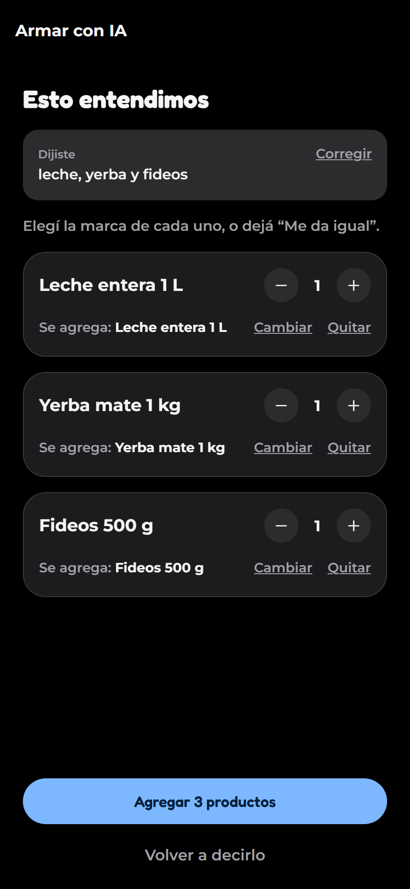

¿Preferís escribir? Tocá **Prefiero escribir**. Si la voz o la IA no están disponibles, la app
sigue funcionando en un **modo básico** que separa tu texto por comas.

> El audio se usa solo para pasarlo a texto y no se guarda.

---

## 5. Elegir tu recorrido y armar una ruta

Son dos cosas distintas:

- **Elegí tu recorrido**: tu camino de hoy, de dónde salís y adónde vas (casa → trabajo). Es lo
  que usa DePaso para buscar comercios "de paso".
- **Armar ruta**: sumás paradas a mano (por ejemplo, pasar por un comercio puntual antes de
  llegar) cuando querés decidir vos el orden.

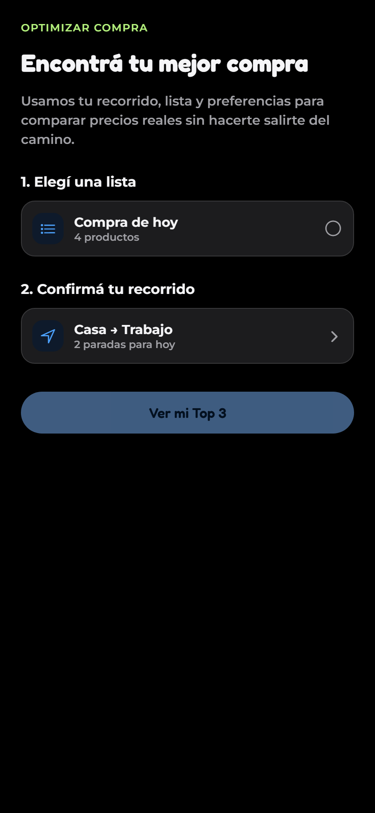

Para elegir el recorrido buscá la dirección como en un mapa: escribís el lugar y aparecen las
sugerencias; al tocar una, queda marcado. También podés usar tus **lugares guardados**.

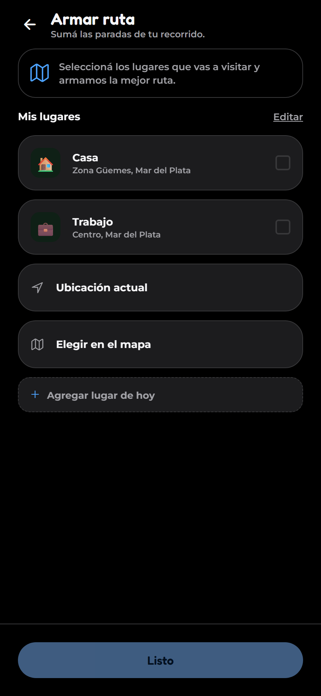

---

## 6. Encontrar la mejor compra

1. En **Inicio**, tocá **Iniciar mi recorrido** (la app te pide lo que falte: lista y recorrido).
2. **Paso 1, "Elegí una lista"**: aparecen las listas que tienen al menos un producto.
3. **Paso 2, "Confirmá tu recorrido"**: revisá el origen y el destino (podés cambiarlos).
4. Tocá **Ver mi Top 3**. DePaso te muestra **hasta 3 planes**:
   - **Mejor equilibrio** (recomendado): ahorro y tiempo en balance.
   - **Más rápido** (*Sin desvíos*): casi no te desviás del camino.
   - **Más económico**: el menor costo de productos.

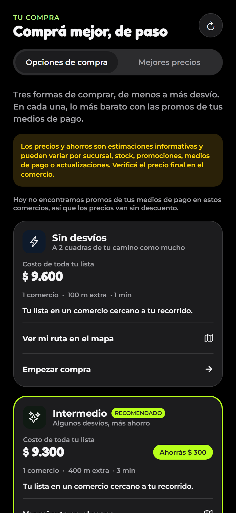

5. Cada plan indica en qué comercios parar, qué comprar en cada uno, el total, cuánto te
   desviás y **cuánto ahorrás**. Si cargaste tus medios de pago, ya descuenta las promos que te
   corresponden. La pestaña **Mejores precios** muestra, producto por producto, dónde está más barato.

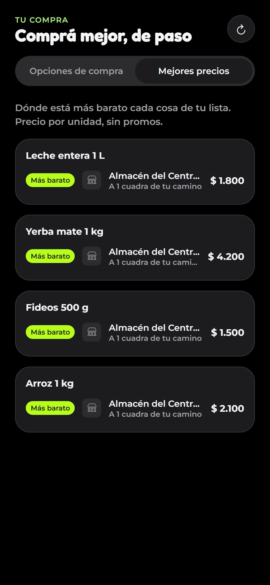

6. Tocá **Ver mi ruta en el mapa** para ver el recorrido con los comercios.

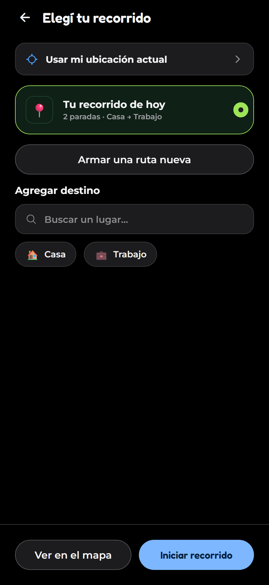

7. En el plan que prefieras tocá **Empezar compra** para pasar al **modo compra**: una lista por
   comercio donde tildás lo que vas comprando. El botón dice **Seguir comprando** (deshabilitado)
   hasta que marcás todo; entonces pasa a **Finalizar compra**.
   El botón con la flecha circular de arriba te deja armar otra optimización.

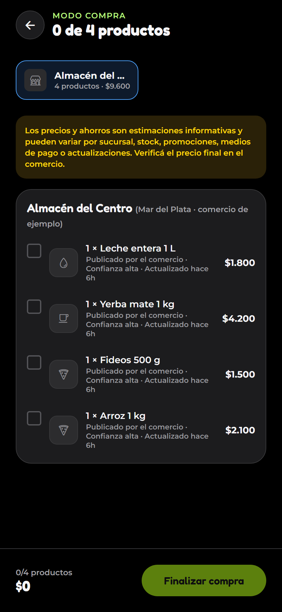

Los precios vienen de fuentes oficiales y de la comunidad, y pueden no estar al día: confirmalos
en el comercio.

### El mapa
En la pestaña **Mapa** ves tu recorrido en pantalla completa, con los **logos de cada comercio**
(Coto, Carrefour, Día…) como marcas. Abajo hay una hoja que **se desliza hacia arriba** para ver
el detalle de cada parada, y arriba un **buscador de lugares**: escribís, elegís una sugerencia y
el mapa te lo señala.

### Reportar un precio
En el modo compra, junto a cada producto hay un enlace **Reportar**. Si viste un precio distinto,
cargalo (y la promo, si hay). Tu reporte ayuda a toda la comunidad; no cambia el precio de
inmediato, primero se verifica.

Al reportar ves también **cuánto lo vieron otras personas** ("Otros usuarios lo vieron a ~$X"),
para que sepas si tu precio es parecido o se aleja.

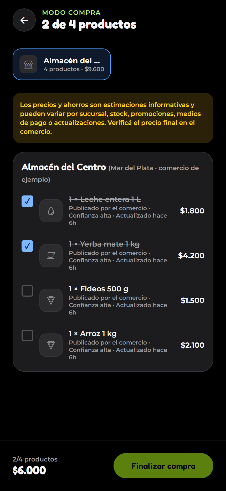

---

## 7. Actividad

La pestaña **Actividad** tiene dos vistas:

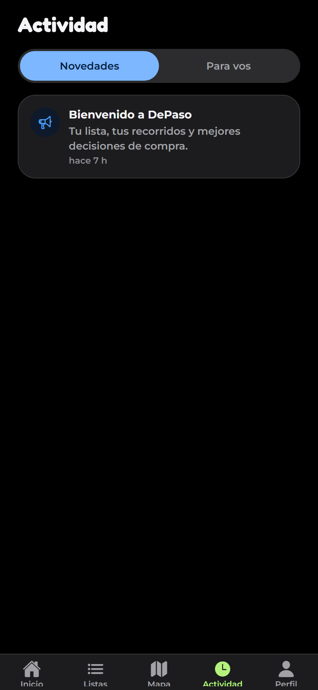

- **Novedades**: anuncios del equipo de DePaso (nuevos comercios, promos, mejoras).
- **Para vos**: avisos personales:
  - alguien te **compartió una lista**;
  - **bajó el precio** de un producto de tus listas;
  - hay una **oferta barata cerca** de tu recorrido.

Tirá hacia abajo para actualizar.

---

## 8. Perfil y configuración

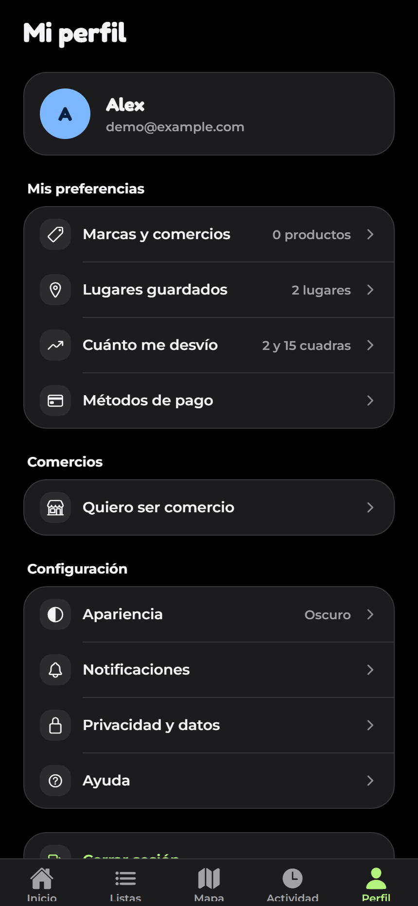

| Opción | Qué hace |
|---|---|
| **Marcas y comercios** | Decís si querés siempre cierta marca, o un comercio para una categoría |
| **Lugares guardados** | Casa, trabajo, etc., para armar recorridos más rápido |
| **Métodos de pago** | Marcás billeteras y tarjetas (Cuenta DNI, Mercado Pago, MODO…) para descontar sus promos |
| **Apariencia** | Claro, oscuro o automático según tu celular |
| **Notificaciones** | Historial de los avisos que te mostró la app |
| **Privacidad y datos** | Descargar tus datos, borrar tus lugares o eliminar la cuenta |
| **Ayuda** | Preguntas frecuentes y textos legales |
| **Cerrar sesión** | Sale de tu cuenta en este celular |

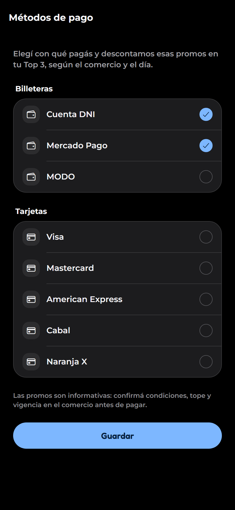

---

## 9. Tipos de usuario

| Rol | Cómo se obtiene | Qué puede hacer |
|---|---|---|
| **Usuario** | Al registrarse | Todo lo descripto arriba |
| **Comercio** | Pedir **Perfil → Quiero ser comercio** y esperar que un administrador lo apruebe | Además: publicar y actualizar los **precios de su comercio** (Perfil → Mis productos y precios) |
| **Administrador** | Lo asigna el equipo de DePaso | Aprobar o rechazar solicitudes de comercio, actualizar promos, moderar reportes y **publicar novedades** |

### Si sos comercio
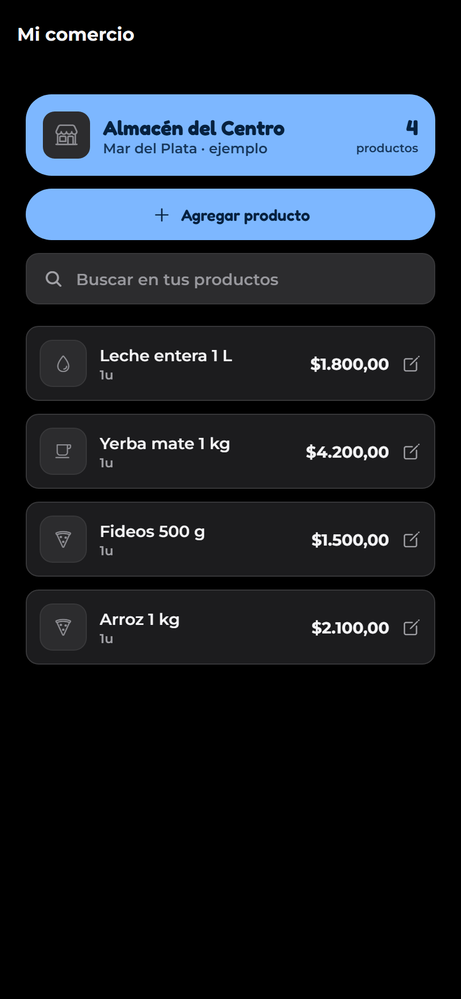

1. Pedí ser comercio con el nombre, la dirección y (opcional) teléfono.
2. Cuando te aprueben, en **Perfil → Mis productos y precios** podés agregar productos del
   catálogo con su precio, crear productos nuevos (con foto), editarlos o darlos de baja. La web
   también tiene este panel.

### Si sos administrador
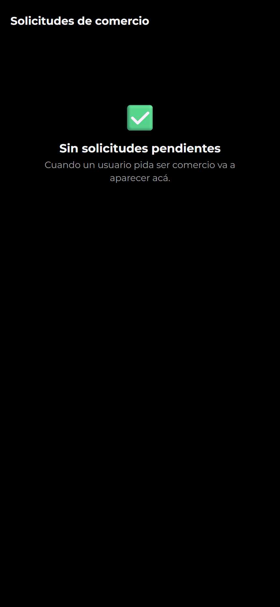

En **Perfil → Administración** ves las **solicitudes de comercio** pendientes (con el contador),
podés **actualizar las promos** de bancos y billeteras y **Publicar novedades** que le aparecen a
todos en **Actividad → Novedades**. El panel web de administración ofrece, además, el ABM de
comercios, sucursales y precios, y la moderación de reportes.

---

## 10. Preguntas frecuentes

**¿Tengo que pagar algo?** No, la app es gratuita.

**No me llega el mail con el código.** Revisá la carpeta de spam y esperá unos segundos antes de
tocar *Reenviar código*.

**La IA no entendió bien lo que dije.** Tocá *Volver a decirlo* o *Prefiero escribir*; siempre
podés corregir cantidades y marcas antes de agregar.

**Un precio está mal.** Reportalo desde el modo compra (*Reportar*).

**¿Por qué mi recorrido de hoy desapareció?** El recorrido de hoy se reinicia a las 00:00. Si lo
guardaste con un nombre, lo tenés en tus rutas guardadas.

**¿Cómo borro mi cuenta?** *Perfil → Privacidad y datos → Eliminar cuenta*. No se puede deshacer.
